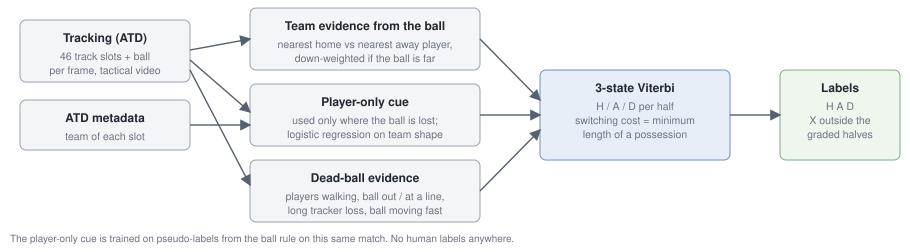
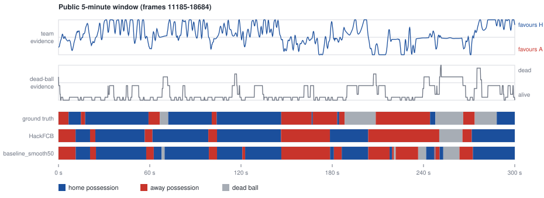
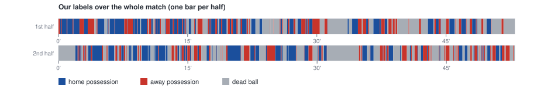

# HackFCB: who has the ball, frame by frame

*More than a Hack 2027, Phase 1 (BAR-ATH). Technical document, team HackFCB.*

| Participant | Email |
|---|---|
| Jasmine Singh Kaur | jasminek1024@gmail.com |
| Carla Lujan | carla.lujan@estudiantat.upc.edu |
| Mir Singh | singhmir62@gmail.com |

## 1. What we did, in short

We label each of the 199,319 frames of the tactical video as home possession (`H`), away possession (`A`), dead ball (`D`), or `X` for the frames the scorer ignores. Everything comes from the tactical tracking file. We did not use video, we did not label anything by hand, and we did not bring in any outside data.

The method is deliberately plain. For every frame we collect a bit of evidence about who is in control and whether the ball is dead, and then we let a small state machine decide where one possession ends and the next begins. Most of our effort went into getting the *number and timing* of possessions to look like a real match, because that is what `spellF1` measures and what the nearest-player baseline gets wrong.

On the public five minutes we get `spellF1` 0.467 and `macroF1` 0.661. The published `baseline_smooth50` gets 0.326 and 0.621 on the same window. Seventeen possessions cannot rank anyone, as the organisers themselves say, so we read this as "the pipeline is aligned and behaves sensibly", not as a forecast. We do not know our score on the full match.



## 2. What we used, and what we left out

| Asset | What we did with it |
|---|---|
| Tactical `*_atd.txt` | Everything. Positions of up to 46 track slots and the ball, per frame. |
| Tactical `*_atd.xml` | Only to know which team each track slot belongs to (first team in the file is the home side). |
| `games.py` | Pitch size (105.3 x 68 m) and the two graded halves. |
| Broadcast tracking | Looked at it, dropped it. It is on a different timeline and aligning it with the tactical one was more work than we had. |
| Homography | Not needed. The ATD positions are already in pitch coordinates. |
| Smart Tagging | Opened it and dropped it. Only 59 set pieces are tagged, each with a 35 s window, which is too coarse to say where a stoppage starts. |
| Videos | Not used. |

## 3. How it works

### 3.1 Who is closer to the ball

The ball is interpolated linearly across gaps of up to one second. On every frame that has a ball we take the distance from it to the nearest home player and to the nearest away player. The difference, divided by 2 m and capped at plus or minus 3, is our evidence for `H` (positive) or `A` (negative). We multiply it by `exp(-d/6 m)`, where `d` is the distance to the nearest player of either team, so that a ball flying through empty space counts for almost nothing.

### 3.2 When the ball is lost

The ball is missing on about 41% of the graded frames, and not in short blinks: in the graded halves there are 150 gaps, the median is around 10 seconds, and almost all missing frames sit in gaps longer than 3 seconds. A nearest-player rule has nothing to say there.

For those frames we use a weak substitute that looks only at the players: how far forward each team's players are (in the direction each team attacks, which we read from where each side stands on the median frame of the first half; the second half is the mirror image, because teams change ends), how wide each team is, where the centre of all players sits and how fast the teams are moving forward. A logistic regression turns that into a score. It is trained on this match's own tracking, using as labels the output of 3.1 on frames where a player is within 2 m of a visible ball. No person labelled anything.

We checked it with 5-fold cross-validation split by time, against those same pseudo-labels: about 75% accuracy, where always guessing the home team would give 60%. That is a real but modest signal, so we gave it a small weight (0.15 times the score, capped at 2). It can only tip a possession if it points the same way for many seconds, and otherwise the label simply carries on from before.

### 3.3 Is the ball dead?

We use rules based on how a stoppage looks, and we did not fit them:

- the median speed of the tracked players over a 4 s window is below 1.5 m/s (people are walking);
- the ball is outside the pitch;
- the ball is within 3 m of a line and moving slowly (under 2.5 m/s);
- the tracker has lost the ball for at least 4 s while the players are walking (here we allow a slightly higher speed, up to 1.9 m/s);
- against all of that, a ball moving faster than 9 m/s is clearly alive.

Each rule adds or subtracts a fixed amount of evidence. A single rule is never enough on its own, because teams do build up slowly with the ball in play.

### 3.4 Turning evidence into possessions

This is the part that matters most for `spellF1`. We run a Viterbi decoder over three states (`H`, `A`, `D`) for each half. Staying in a state follows the evidence; switching between `H` and `A`, or between alive and dead, costs 60 units. In practice a change of possession needs two to three seconds of clear evidence, and a stoppage needs around five. That removes the flicker that makes a per-frame rule invent hundreds of one-second possessions.



### 3.5 Two fixed rules from the organisers

Outside the two graded blocks (frames 11185 to 90651 and 110808 to 190197) we write `X`. Inside play we never write `X`: the scorer would fill it with the previous label anyway, and the decoder already carries a label through gaps.

The second half is graded from frame 110808 but kicks off at 113742, and the organisers' FAQ says those 2,934 frames are all dead ball. We force `D` there. We found this late, by rereading the FAQ, and it was wrong in our first file.

## 4. Possession rules we implemented

- A possession is a run of one team with the ball alive. A stoppage always splits two possessions: `H D H` is two.
- With a loose or contested ball, possession stays with the last team that had clear evidence. Because a flip needs a few seconds of support, rebounds, deflections and single touches do not create a change.
- We approximate control by proximity: the nearest player, weighted by how close the ball is. Frames where the ball is far from everyone count for little.
- We do not model restarts. A stoppage ends when the evidence for it fades, and the next possession goes to whoever is nearest then. We never try to say who owns a dead ball; `D` has no team.

## 5. Training data

We used no labelled data of any kind. The only learned part is the small regression in 3.2, fitted on pseudo-labels that our own rule produced on this match. We did not train or fit anything on the public ground truth.

We should be open about how we used the public five minutes. We looked at them to understand what a dead-ball stretch looks like in the tracking, which the challenge text encourages. Our first dead-ball detector was a Gaussian mixture on player speed; it produced no `D` at all in that window, so we dropped it for the rules in 3.3. The 1.5 m/s walking threshold came from looking at player speeds there. We did not run any automatic search on the public score. We did try a few switching costs and line distances (cost 40, 60, 90 and 3 or 6 m) and looked at how many possessions came out (roughly 210 to 330) to check the method was not fragile; we kept 60 because it gave possessions of a realistic length, not because it scored best.

## 6. Results and what they mean

| On the public window (7,500 frames, 17 possessions) | `macroF1` | `spellF1` |
|---|---|---|
| HackFCB | 0.661 | 0.467 |
| baseline_smooth125 | 0.581 | 0.424 |
| baseline_smooth50 (published floor) | 0.621 | 0.326 |

Dead ball is where we are weakest: precision 1.00 but recall 0.26. We output 13 possessions against 17 real ones, and 8 of ours match a real one at IoU 0.5.

On the whole match the output has 264 possessions of 14.7 s on average and 106 stoppages of 23.4 s on average; dead ball is 39% of the graded frames. Those numbers look like football, but we have no way to check them against the truth.



## 7. Where it fails, and what we would do next

- **Missed stoppages.** When the ball stays tracked and the players keep moving (a quick throw-in, a free kick taken at once) we see nothing unusual and the two possessions merge.
- **Long gaps without the ball.** The player-only cue is weak, so a wrong team can survive a long gap.
- **Hand-set constants.** The thresholds are physical numbers we chose, not values fitted on labelled data. On another match they should be rechecked.

With more time we would use the Smart Tagging windows as a prior for restarts, align the broadcast tracking to recover ball positions, detect kicks from the ball's own motion, and fit all of this on labelled matches other than this one.

## 8. Reproducing the file

```bash
pip install -r requirements.txt            # we used Python 3.14.10
# unpack the gated bundle into data/ (see data/README.md)
python -m mtah.pipeline --out submission/HackFCB.csv
python evaluation/validate_submission.py submission/HackFCB.csv
```

The run is deterministic (two runs give the same file) and takes under a minute. The match data is not in the repository; `data/` is git-ignored. The figures in this document are rebuilt with `python docs/make_figures.py`, and the PDF with `python docs/build_report.py`.
